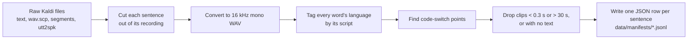
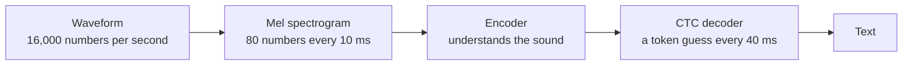

# MoA-CAS — The Complete Guide

**Mixture-of-Adapters for Code-Switched Speech Recognition**, explained from the ground up.

This guide teaches the whole project in plain language: the problem, the data, how speech recognition works, the model we build on, the two things we add (adapters and a router), how they're trained, how we measure them, what we found, and what's still missing. You don't need a speech-processing background; each idea is explained the first time it appears.

Every number here comes from the repository's own files. Where a number has a source file, it's named. For the full claim-by-claim evidence list, see [THESIS_REFERENCE.md](THESIS_REFERENCE.md).

---

## Contents

1. [The project in one page](#1-the-project-in-one-page)
2. [The problem: code-switched speech](#2-the-problem-code-switched-speech)
3. [The data](#3-the-data)
4. [Speech recognition basics you need](#4-speech-recognition-basics-you-need)
5. [The backbone model](#5-the-backbone-model)
6. [Stage 1 — Adapters (Profile Learning)](#6-stage-1--adapters-profile-learning)
7. [Stage 2 — The router (Fluidity Learning)](#7-stage-2--the-router-fluidity-learning)
8. [How we measure: evaluation method](#8-how-we-measure-evaluation-method)
9. [Results](#9-results)
10. [Comparison with the base paper](#10-comparison-with-the-base-paper)
11. [Limitations and what's next](#11-limitations-and-whats-next)
12. [Running everything](#12-running-everything)
13. [Glossary](#13-glossary)

---

## 1. The project in one page

**The problem.** Millions of Indians speak Hindi and English mixed together in a single sentence: *"अब **slide** पर **click** करें"*. Speech recognisers trained on one language at a time do badly on this.

**The idea.**
1. Take a strong, pretrained Indian-language speech model and **freeze** it: never change any of its weights. That way it can't forget what it already knows.
2. Insert small trainable **adapters** inside it. Each adapter is a specialist; ours is a Hindi adapter. Only about 1% of the model's size is trained.
3. Add a **router** that decides, every 40 milliseconds of audio, how much of each specialist to use. That lets the system follow a speaker who switches language mid-sentence.

**The two training stages.**

| | Stage 1 — Profile Learning | Stage 2 — Fluidity Learning |
|---|---|---|
| Backbone model | frozen | frozen |
| Adapters | **trained**, one language at a time | frozen |
| Router | not used | **trained** |
| Data | monolingual (pure Hindi) | code-mixed Hindi-English |
| Loss | CTC | CTC + load balancing |
| Learns | what Hindi in this domain sounds like | when to use which specialist |

**What we found** (100 Hindi-English test utterances; lower WER is better):

| System | Word error rate |
|---|---|
| Base model (frozen, nothing added) | 58.06% |
| Base + Hindi adapter | **48.72%** |
| Base + adapter + router | 52.94% |

- The adapter helps clearly and significantly.
- The router also beats the base model, but not yet the adapter alone.
- About 25% of the reference words are English in Latin letters, which this model has no way to write. That sets a floor on how low the error can go.

---

## 2. The problem: code-switched speech

### What code-switching is

**Code-switching** means changing language inside one conversation or one sentence. Hindi-English speakers do it constantly, especially for technical words:

> लिबर ऑफिस **impress** में एक प्रस्तुति **document** बनाना और बुनियादी **formatting** के इस **spoken tutorial** में आपका स्वागत है

A **code-switch point** is a place where two neighbouring words are in different languages. The sentence above has 8 of them.

### Why speech recognisers struggle

A speech recogniser (**ASR**, automatic speech recognition) learns sound patterns and spellings from its training data. A Hindi model has learned Hindi sounds and Devanagari spelling. When an English word arrives, it can:
- hear it correctly but spell it in Devanagari (`document` → `डॉक्यूमेंट`);
- hear it as some unrelated Hindi word;
- or lose track and drop or invent words.

### The obvious fix and why we don't use it

You could **fine-tune** the whole model on code-mixed speech, i.e. keep training all of its weights. That has two problems:
- **Catastrophic forgetting.** The model gets better at mixed speech but worse at the plain Hindi it used to handle well.
- **Cost.** Training hundreds of millions of weights per language pair is expensive, and you end up storing a full copy of the model for each pair.

MoA-CAS avoids both by freezing the model and training only small add-ons.

### Where the idea comes from

| Paper | What we take from it |
|---|---|
| Gulati et al. 2020, *Conformer* | The encoder architecture our backbone uses |
| Winata et al. 2020, *Code-switched ASR without forgetting monolingual* | The goal: gain code-switching ability without losing the original language |
| **Kulkarni et al. 2023, *Adapting the Adapters for Code-Switching*** (arXiv:2310.07423) | **The base method.** Language adapters, mixed by a learned gate at every layer and every audio frame. Our router extends their two-way gate to K experts. |
| Zhao et al. 2024, *CAMEL* (arXiv:2412.12760) | Mixture-of-experts for code-switching, and using language information to guide routing |
| Fedus et al. 2022, *Switch Transformers* | The load-balancing loss that keeps a router from ignoring an expert |

---

## 3. The data

### 3.1 The corpora

**MUCS 2021** (Multilingual and Code-Switching ASR challenge, from OpenSLR, resource 104) is our main dataset. It's recordings of **spoken software tutorials**: someone explaining LibreOffice, Linux or C programming, in Hindi or Bengali mixed with English.

| Split | Utterances | Hours | Speakers | English share of words | Code-mixed utterances |
|---|---|---|---|---|---|
| Hindi-English train | 52,769 | 88.98 | 520 | 25.3% | 83.9% |
| Hindi-English test | 3,132 | 5.14 | 30 | 24.6% | 80.0% |
| Bengali-English train | 26,563 | 45.50 | 267 | 31.6% | 85.6% |
| Bengali-English test | 4,275 | 7.00 | 40 | 33.3% | 87.5% |
| **Total** | **86,739** | **146.62** | **857** | — | — |

**IndicVoices** (AI4Bharat) is our **monolingual reference**: natural Hindi speech (read, spontaneous and conversational) with almost no English (1.5% of utterances code-mixed). We use it only to see how well the model does on "normal" Hindi.

Source: [02_DATA_PREPROCESSING.md](02_DATA_PREPROCESSING.md), recomputed from the manifests.

### 3.2 How raw data becomes training data

MUCS arrives in **Kaldi format**: long recordings, plus text files saying "sentence X is in recording Y from second *a* to second *b*, and its words are …". The pipeline turns that into one clean audio file and one row of metadata per sentence.



1. **Cut.** Slice each sentence's `[start, end]` window out of its long recording.
2. **Standardise audio.** Mix down to one channel (mono) and resample to 16,000 samples per second, the format the model expects.
3. **Tag languages.** For each word, look at which alphabet its letters come from: Devanagari → Hindi, Bengali script → Bengali, Latin → English.
4. **Find switches.** Every time two neighbouring words have different tags, count a code-switch point.
5. **Filter.** Drop clips that are too short to be speech, too long for one model input, or have no transcript.
6. **Write the manifest.** One JSON line per sentence.

Code: `src/moa_cas/preprocessing/` (audio and text), `src/moa_cas/pipeline/` (orchestration). Command: `python scripts/build_manifest.py --config mucs_hi_en_test`.

**How we know the tagging is right.** Biswas et al. (2025) publish their own counts for the same Hindi-English test split. Ours agree within 1–6%: duration 5.14 h vs 5.2 h, Hindi words −0.9%, English words −5.5%, code-switch points −1.8%.

### 3.3 What one manifest row looks like

```json
{
  "utt_id": "103085_w5Jyq3XMbb3WwiKQ_0000",
  "audio_filepath": "data/processed/mucs/hi-en/test/103085_w5Jyq3XMbb3WwiKQ_0000.wav",
  "text": "लिबर ऑफिस impress में एक प्रस्तुति document बनाना और बुनियादी formatting के इस spoken tutorial में आपका स्वागत है",
  "duration": 8.0,
  "n_words": 19, "n_words_l1": 14, "n_words_en": 5,
  "n_cs_points": 8, "is_code_mixed": true,
  "speaker_id": "103085"
}
```

`n_words_l1` counts the main language (Hindi here) and `n_words_en` counts English. These counts let us pick subsets without touching the audio. For example, `n_words_en == 0` gives the pure-Hindi sentences used to train the Hindi adapter.

### 3.4 Subsets we actually use

| Subset | Definition | Size | Used for |
|---|---|---|---|
| Pure-Hindi training pool | Hindi-English **train**, 0 English words, 1–10 s long | 7,083 utterances | Stage 1 (adapter) |
| Code-mixed training pool | Hindi-English **train**, at least one switch, 1–10 s | (default cap: 8,000 used) | Stage 2 (router) |
| Evaluation — mixed | First 100 utterances of Hindi-English **test** | 100 | All results |
| Evaluation — pure Hindi | First 100 test utterances with 0 English words | 100 | All results |

**Train and test never share a speaker.** Train has 520 speakers and test has 30, with zero overlap (checked by `tests/test_results.py`). So every result is on voices the model never trained on.

### 3.5 Two quirks of this data you must know

1. **Clips are cut on whole seconds.** MUCS's segment boundaries all land on integer seconds and tile each recording with no gaps. Real speech doesn't stop on the second, so many clips start with the last word or two of the *previous* sentence. In our analysis, 39% of hypotheses begin with words from the previous sentence. Those words aren't in the reference, so they count as errors no system can avoid.
2. **It's tutorial speech.** Even pure-Hindi MUCS sentences score far worse than IndicVoices Hindi: 58.96% vs 11.72% WER (the 12 pure-Hindi sentences among the first 100 test utterances, ONNX model). Most of the difficulty is the domain (technical vocabulary, recording conditions), not the code-switching. See [01_BASELINE_AND_PROBLEM_ANALYSIS.md](01_BASELINE_AND_PROBLEM_ANALYSIS.md).

---

## 4. Speech recognition basics you need

### 4.1 From sound to text



1. **Waveform.** Audio is a list of air-pressure measurements, here 16,000 per second.
2. **Mel spectrogram.** Every 10 ms, take a 25 ms slice of audio and measure how much energy it has at 80 pitch bands, spaced the way human hearing works. This turns sound into something like a picture of frequencies over time.
3. **Encoder.** A large neural network reads that picture and produces, for each moment, a list of 512 numbers describing what's being said. This list is called a **hidden state** or **representation**.
4. **Decoder.** Turns each moment's representation into a guess about which piece of text is being spoken.
5. **Text.** The guesses are joined into words.

### 4.2 Tokens

Models don't output whole words; they output **tokens**, i.e. common word-pieces. The Hindi tokenizer has 256 pieces. Real example: `स्लाइड` is spelled with 4 tokens, `▁स्` `ला` `इ` `ड`. The `▁` marks the start of a new word.

### 4.3 CTC: Connectionist Temporal Classification

Audio is long and text is short: a 3-second clip is 75 encoder steps but might be only 10 tokens. **CTC** solves the alignment problem like this:
- At **every** time step, the model outputs either a token or a special **blank** ("nothing new here").
- To read the output, **merge repeated tokens**, then **remove blanks**:

```
time steps : स्  स्  _  ला  इ  इ  _  ड  _
merge      : स्      _  ला  इ     _  ड  _
drop blanks: स्लाइड
```

During **training**, the CTC loss adds up the probability of every possible way of spreading the correct tokens over the time steps, and pushes that total up. So you only need the transcript, not where each word starts. During **decoding**, we use **greedy** CTC: at each step take the single most likely symbol, then merge and drop blanks. No language model or beam search is involved, so the numbers show the acoustic model alone.

One rule follows: **CTC needs at least as many time steps as tokens**, plus room for blanks between repeated tokens. A clip that's too short for its transcript can't be aligned, and its loss becomes infinite (§6.5).

### 4.4 Measuring errors: WER and CER

**Word Error Rate (WER)** = (substituted + deleted + inserted words) ÷ words in the reference.

```
reference : अब insert  और slide  पर click  करें        (7 words)
hypothesis: अब इंसर्ट  और स्लाइड  पर क्लिक  करें
errors    :    sub         sub        sub              → 3 / 7 = 42.9% WER
```

**Character Error Rate (CER)** is the same calculation on characters instead of words. It's gentler on near-misses.

WER can go above 100% when the model **invents** many extra words.

---

## 5. The backbone model

### 5.1 Why we use the NeMo IndicConformer

Our baseline benchmark first used `ai4bharat/indic-conformer-600m-multilingual`. It's accurate, but it ships as **ONNX**, a frozen, run-only format with no way to train or insert layers. So the adapters sit on AI4Bharat's **per-language NeMo checkpoint**, `ai4bharat/indicconformer_stt_hi_hybrid_ctc_rnnt_large`, which is ordinary trainable PyTorch.

Loading it took five workarounds for problems in the published checkpoint: a gated repository, a broken auto-restore, a nested tokenizer config, dataset stubs that crash, and a constructor argument from a private NeMo fork. Each is explained in [04_HOW_THE_ADAPTER_SYSTEM_WORKS.md](04_HOW_THE_ADAPTER_SYSTEM_WORKS.md). Code: `src/moa_cas/adapters/nemo_backbone.py`.

> In the thesis, name both models: the **600 M ONNX** model for the baseline benchmark, and the **118 M NeMo** model under the adapters and router.

### 5.2 Architecture, with exact settings

| Part | Setting (from the checkpoint's `model_config.yaml`) |
|---|---|
| Input | 16 kHz audio |
| Features | 80 mel bands; 25 ms window, 10 ms step (100 frames/s); Hann window, 512-point FFT; per-feature normalisation |
| Subsampling | ×4 by strided convolution → **25 frames per second, 40 ms per frame** |
| Encoder | **17 Conformer layers**, width **512**, **8** attention heads, relative-position self-attention, convolution kernel 31, feed-forward ×4 |
| Encoder size | **115,111,424** parameters |
| Decoder used | CTC head, 512 → 5,633 outputs, **2,889,729** parameters |
| Total backbone | **118.0 M** parameters, all frozen |

(The checkpoint also contains an RNN-T decoder. We never build it; only the CTC path is used.)

**A Conformer layer** combines two ideas. **Self-attention** lets each moment look at the whole utterance (good for context), and **convolution** looks closely at nearby moments (good for the fine detail of sounds). Each of the 17 layers refines the representation a little further.

### 5.3 The shared vocabulary and the language mask

The CTC head outputs **5,633 classes**: 22 Indian languages × 256 tokens = 5,632, plus one shared blank. A Hindi tokenizer only knows its own 256 tokens, so we need to know which 256 columns are Hindi's.

The answer is the **language mask**. The vocabulary is laid out in **contiguous blocks** in the order the languages are listed, and Hindi is the 7th language, so its block is columns **1536–1791**. The mask keeps those 256 columns plus the blank, giving a 257-way choice. Code: `src/moa_cas/adapters/language_mask.py`. It checks the block against the tokenizer on every load and fails loudly if they don't match.

> **A lesson from this project.** The first version matched tokens by their *spelling*. 670 spellings appear in more than one language, so 213 of Hindi's 256 columns (83%) pointed at the wrong language. Training loss still went down, because the model happily learned the scrambled targets. Only measuring WER (88.56%) exposed it. *A falling loss proves nothing; always measure the output.*

### 5.4 The hard limit: no English letters

Of all 5,632 tokens, the only one containing a Latin letter is `<unk>` ("unknown"). **The model physically can't write "document"**; the best it can do is `डॉक्यूमेंट`. Since about 25% of MUCS reference words are written in Latin script, those words always count as errors under exact-match WER, whatever we add. Adapters and routers change what the encoder **hears**; they can't change what the decoder is able to **write**.

---

## 6. Stage 1 — Adapters (Profile Learning)

### 6.1 What an adapter is

An **adapter** is a tiny network inserted after each encoder layer. It takes the layer's output and adds a small correction:

```
h  ──►  down-project 512→64  ──►  ReLU  ──►  up-project 64→512  ──►  + h  ──►  out
└──────────────────────────────── skip connection ────────────────────┘
```

In symbols: **out = h + Up(ReLU(Down(h)))**.

- **Bottleneck.** Squeezing 512 numbers through 64 keeps it small. It can only learn a compact correction, not rewrite everything.
- **Residual ("+ h").** The original signal always passes through. The adapter only adds an adjustment.
- **Zero-initialised.** The up-projection starts at all zeros, so at the start the adapter adds exactly nothing, and the model behaves exactly as it did before training (checked by a test).

Code: `src/moa_cas/adapters/bottleneck.py`.

### 6.2 Where adapters go

One adapter after **each** of the 17 Conformer layers. They're attached with PyTorch **forward hooks**: small callbacks that run right after a layer and replace its output. The pretrained model's own code and weights are never edited, so adapters can be saved, swapped or removed independently.

### 6.3 Size

Per layer: 512×64 + 64 + 64×512 + 512 = **66,112** parameters. × 17 layers = **1,123,904** trainable parameters, which is **0.98%** of the encoder.

### 6.4 Training configuration

| Setting | Value | Why |
|---|---|---|
| What trains | Adapter weights only | The backbone is frozen (no gradients; checked by a test) |
| Data | Pure-Hindi MUCS train utterances, 1–10 s, CTC-feasible | Teaches "Hindi in this domain" without English confusing it |
| Loss | CTC over the 257-way Hindi view | Matches how the backbone was trained |
| Optimiser | Adam, learning rate 1e-3 | Standard, fast for small modules |
| Batch size | 1 (CPU) | No GPU was available |
| Gradient clipping | max norm 5.0 | Stops one bad sample from wrecking the weights |
| Augmentation / dropout | None (backbone kept in evaluation mode) | Keeps the frozen model's behaviour exactly as published |
| Stopping | Fixed wall-clock limit (`--max-seconds`) | No dev split yet (see §11) |
| **Recorded run** (`checkpoints/hi_adapter.pt`) | **1,933 steps, 1 epoch, 1,933 utterances**, bottleneck 64, lr 1e-3 | Read from the checkpoint file |

Command: `python scripts/train_profile_adapter.py --lang hi --max-seconds 3600 --save-to checkpoints/hi_adapter.pt`

### 6.5 Three safety guards (learned the hard way)

An early 5-hour run reported success but had silently broken at **step 289 of 39,236**. A 1.56-second clip didn't have enough frames for its transcript, so CTC gave infinite loss, which turned every weight into `NaN` (not-a-number) for the remaining 4.95 hours. Three guards now prevent this:

1. **Pre-filter.** Skip clips where `frames < 2 × tokens`.
2. **`zero_infinity=True`.** Impossible samples contribute 0 loss instead of infinity.
3. **Gradient clipping.** No single step can move the weights too far.

### 6.6 What it achieved

| Test set (100 utterances) | Base | + Adapter | Change | Significance |
|---|---|---|---|---|
| Pure Hindi | 72.28% | **60.35%** | −11.9 points | 51 better / 25 worse; t = −4.45 |
| Mixed | 58.06% | **48.72%** | −9.3 points | t = −3.83 |

**Why it helps.** The frozen model **under-produces** on this audio: it outputs only 0.75 words per reference word, cutting sentences short. The adapter raises that to about 0.85, recovering dropped words.

**How far the claim goes.** The gain is concentrated in words the adapter saw during training (+12.2 points recall) rather than new words (+6.1 points, not significant). This split was measured on the earlier, since-overwritten checkpoint with the old scorer, so treat it as indicative. So this is **in-domain adaptation**: a real improvement on this kind of material, not proof of better Hindi or code-switching in general.

---

## 7. Stage 2 — The router (Fluidity Learning)

### 7.1 The idea

Different parts of a sentence may need different specialists. The **router** looks at the audio at every layer and every 40 ms frame, and decides how to mix the experts:

```
                 ┌─► Expert 1: Hindi adapter ─────┐
h (one layer,  ──┼─► Expert 2: identity (no change)┼──► weighted sum ──► next layer
   one frame)    └─► Router ─► weights w₁, w₂ ────┘
```

The formula, at every layer *l* and frame *t*:

- **wₜ = softmax(Routerₗ(hₜ))**: K weights that are each between 0 and 1 and add up to 1.
- **outₜ = Σₖ wₜ,ₖ · Aₖ(hₜ)**: a weighted blend of the experts' outputs.

**Softmax** turns any list of scores into weights that are positive and sum to 1.

This generalises Kulkarni et al.'s gate, out = (1 − g)·A₁ + g·A₂, from 2 experts to any number K. A `hard` mode picks only the top expert per frame, like their 0/1 gate.

### 7.2 The router network (one per layer)

```
h (512) → LayerNorm → depthwise conv over 5 frames (200 ms context) → Linear 512→128 → ReLU → Linear 128→K → softmax
```

- **LayerNorm** rescales the input so the router sees a steady range of values.
- **Context window.** A language switch spans several frames, so each frame also looks at 2 frames either side. Padding frames are zeroed so they don't leak in.
- **Zero-initialised output.** An untrained router gives exactly equal weights (50/50 for two experts). That's a known starting point and a baseline to beat.

Size: 70,018 parameters per layer × 17 = **1,190,306**. With the adapter, the total trainable add-on is **2,314,210 = 1.96%** of the 118 M backbone, just inside the project's "< 2%" target.

Code: `src/moa_cas/adapters/router.py`.

### 7.3 The experts we can use today

All experts must sit on the **same** frozen backbone, because an adapter only makes sense on the model it was trained with.

| Expert | Status |
|---|---|
| Hindi adapter (Stage 1) | ✅ trained |
| **Identity**: "no change", i.e. the original backbone | ✅ always available. It also guards against forgetting, since the router can switch the adapter off where it hurts. |
| English adapter | ⛔ blocked: no English speech data, and no Latin letters to output (§5.4) |
| Bengali adapter | Lives on a different backbone, so it can't share this router |

So the router currently chooses between **Hindi-adapted** and **original** processing, not yet between Hindi and English. Adding an English expert later means adding one `--expert` flag; no code changes are needed.

### 7.4 Load-balancing loss

Left alone, a router can lock onto one expert early and never try the other. The **load-balancing loss** (from Switch Transformers) penalises that:

**LB = K × Σₖ fₖ · Pₖ**

- fₖ = share of frames whose top choice is expert k
- Pₖ = average weight given to expert k

LB equals **1.0** when the experts share the work evenly and **K** when one expert takes everything. Only real frames count, not padding.

**Total loss = CTC + α × LB**, with α = 0.01, so balancing is a gentle nudge rather than the main goal.

### 7.5 English words in the training targets

The router learns from CTC on code-mixed sentences, but no expert can write Latin letters. With the default setting `--english-targets drop`, English words are removed from the training transcript, so the frames where they're spoken are free to output blank. (The alternative, `keep`, turns them into `<unk>` tokens.)

### 7.6 Training configuration

| Setting | Value |
|---|---|
| What trains | Router weights only; backbone **and** adapter frozen |
| Experts | `hi` (Stage 1 adapter) + `identity` |
| Data | Code-mixed MUCS train utterances, 1–10 s, CTC-feasible after dropping English words |
| Loss | CTC + 0.01 × load balancing |
| Optimiser | Adam, learning rate 1e-3, gradient clipping 5.0 |
| Router | hidden size 128, context 5 frames, temperature 1.0 |
| **Recorded run** (`checkpoints/router_hi_id.pt`) | **38,531 steps, 5 epochs** (batch size 1, about 7,700 utterances per epoch) |

Command: `python scripts/train_router.py --lang hi --expert hi=checkpoints/hi_adapter.pt --expert identity --save-to checkpoints/router_hi_id.pt`

### 7.7 What it achieved

| Test set | Base | Adapter alone | Router | Router vs base | Router vs adapter |
|---|---|---|---|---|---|
| Mixed | 58.06% | **48.72%** | 52.94% | −5.1 points, t = −2.59 ✅ | +4.2 points, t = +2.68 ❌ |
| Pure Hindi | 72.28% | **60.35%** | 64.78% | −7.5 points, t = −3.57 ✅ | +4.4 points, t = +2.85 ❌ |

**Reading it plainly.** The router works and significantly beats the base model, but it's significantly *worse* than simply using the adapter everywhere. It learned an almost constant blend of about 46% adapter / 54% original on nearly every frame, and that blend doesn't follow where English words are (correlation r = 0.02). In effect, it gives half the adapter's benefit everywhere.

**Likely reasons, not yet tested:**
- Its second expert is "no change", not an English specialist, so there's nothing language-specific to route to.
- Dropping English words from the targets gives it little reason to treat English frames differently.
- It was trained elsewhere, and which adapter file it trained against wasn't recorded; a mismatch with the on-disk adapter is possible.

---

## 8. How we measure: evaluation method

### 8.1 The procedure

1. Take the **first 100** utterances of the Hindi-English test split (and, separately, the first 100 pure-Hindi ones).
2. Decode each with greedy CTC (deterministic: same input, same output every time).
3. Normalise reference and hypothesis the same way: Unicode NFC, lowercase, remove punctuation and symbols, collapse spaces. **Hindi vowel signs (ि ी ं ्) are kept.**
4. Compute WER and CER with `jiwer`.
5. Compare systems **on the same 100 utterances** with a **paired t-test**: for each utterance, take system A's WER minus system B's. This asks "did it help *on the same sentence*?", which is fairer than comparing two averages. We report how many got better, worse or stayed the same, plus the t-value and 95% confidence interval. As a rough rule, |t| > 2 means the difference is unlikely to be chance.

Every system's per-utterance results are saved as CSVs in `results/`, and `tests/test_results.py` re-checks every headline number from them.

### 8.2 A correction you should know about (C6)

Until 2026-10-26, the scoring code accidentally **deleted every Hindi vowel sign, anusvara and virama** before comparing. A regex detail (`\w` doesn't match combining marks) meant `कि` and `की` counted as the same word. That made every error rate 2–7.5 points too low. It's fixed, all results were rescored from the saved transcripts, and every comparison still points the same way. Older figures such as 7.93% and 57.14% (in the review deck) are the under-counted versions; the correct ones are 11.72% and 59.69%. A test now fails if any stored score disagrees with the metric.

### 8.3 Transliteration-aware scoring

Standard WER can't tell **"didn't understand"** from **"understood but wrote it in Devanagari"**. `scripts/score_transliteration_aware.py` converts both sides into rough Latin sounds (`डॉक्यूमेंट` → *dokiunent*, `document` → *dokunent*) and scores again.

On the mixed set, the base model's CER drops from 55.30% to 33.88%: much of the "error" is spelling script, not hearing. On pure Hindi, where there's no English, it still drops about 4 points (59.17% → 55.03%), because the conversion also forgives some genuine vowel mistakes. Read the mixed-set gain net of that.

The demo uses the same idea to colour such words **blue** ("same word, other script"). That's for display only; WER still counts them as errors.

### 8.4 What the sample size means

100 utterances gives 95% confidence intervals of roughly ±5 points. The full test split has 3,132 utterances; scoring all of them is the most important next step for trustworthy numbers.

---

## 9. Results

### 9.1 All headline numbers

| What | WER | CER | File |
|---|---|---|---|
| ONNX model, IndicVoices Hindi (clean) | 11.72% | 4.57% | `results/indicvoices_hi_ctc.csv` |
| ONNX model, MUCS Hindi-English | 59.69% | 59.12% | `results/mucs_hi_en_ctc.csv` |
| NeMo base, mixed | 58.06% | 55.30% | `results/adapter_eval/nemo_baseline_fixed.csv` |
| NeMo base, pure Hindi | 72.28% | 59.17% | `results/adapter_eval/eval_base_pure.csv` |
| + Adapter, mixed | **48.72%** | 48.26% | `results/adapter_eval/eval_adapt_mixed_ckpt0917.csv` |
| + Adapter, pure Hindi | **60.35%** | 44.97% | `results/adapter_eval/eval_adapt_pure_ckpt0917.csv` |
| + Router, mixed | 52.94% | 50.03% | `results/router_eval/router_hi_id_mixed.csv` |
| + Router, pure Hindi | 64.78% | 50.85% | `results/router_eval/router_hi_id_pure.csv` |

### 9.2 What you can and can't claim

**You can claim:**
- Freezing a 118 M-parameter Indic model and training 1.1 M adapter parameters gives a **significant, held-out improvement**: −12 WER points on pure Hindi and −9 on mixed speech.
- A frame-level router over frozen adapters can be trained end to end with 1.2 M parameters, and it significantly beats the frozen model.
- The original model is never changed and stays exactly recoverable (identity expert, tested).
- Most of the MUCS error is domain and segmentation, not code-switching (pure-Hindi MUCS 58.96% vs IndicVoices 11.72%).

**You can't claim (yet):**
- That the router beats the adapter alone, or that it routes by language.
- That the system solves code-switching: English can't be written, and there's no English expert.
- Gains on other corpora: the improvement is concentrated in seen vocabulary.

---

## 10. Comparison with the base paper

Kulkarni et al. 2023 report on the **same** 3,132-utterance MUCS Hindi-English test set (Table 1; check exact values against the PDF):

| System | Backbone | WER | CER |
|---|---|---|---|
| Kulkarni: MMS + Hindi adapter | MMS, 965 M | 58.05% | 49.20% |
| **Kulkarni: TCS (frame-level gate, their best)** | MMS, 980 M | **57.95%** | **38.26%** |
| Ours: base | IndicConformer, 118 M | 58.06% | 55.30% |
| Ours: + Hindi adapter | 118 M + 1.1 M | 48.72% | 48.26% |
| Ours: + router | 118 M + 2.3 M | 52.94% | 50.03% |

**Not directly comparable yet.**
1. They scored all 3,132 utterances; we scored the first 100, which come from a single tutorial series.
2. Their text normalisation isn't stated, so ours may differ.
3. The backbones differ.

The fair version of the comparison needs us to score all 3,132 utterances, ideally with both our normalisation and none.

---

## 11. Limitations and what's next

| Limitation | Effect | Next step |
|---|---|---|
| No Latin tokens in the decoder | ~25% of reference words can never be exactly right | Extend the vocabulary, or train on transliterated targets |
| No English expert | The router can't route by language | Source English speech data; train an English adapter |
| n = 100 evaluation | Wide confidence intervals | Score all 3,132 test utterances |
| No dev split | No early stopping or tuning | Use `pipeline/splits.py` (speaker-disjoint split) |
| Clips cut on whole seconds | Unavoidable errors from neighbouring speech | Re-segment with forced alignment or VAD |
| CPU-only training | Short runs | Train on GPU (code supports `--device cuda`) |
| Bengali never trained | Equity axis untested | Run `--lang bn` |
| No word timestamps | Can't measure accuracy at switch points (CS-WER / CBA) | Forced alignment |
| Adapter checkpoint once overwritten (C1) | An earlier result can't be reproduced | Record a hash for every checkpoint |

---

## 12. Running everything

Setup (Python 3.10+):

```bash
python -m venv venv
```

```bash
source venv/bin/activate
```

```bash
pip install -e ".[adapters]" pytest
```

| Task | Command |
|---|---|
| Run all tests | `python -m pytest -q tests` |
| Build a manifest | `python scripts/build_manifest.py --config mucs_hi_en_test` |
| Baseline benchmark (ONNX) | `python scripts/benchmark.py --dataset compare --mucs-manifest data/manifests/mucs_hi-en_test.jsonl --limit 100` |
| Train the adapter | `python scripts/train_profile_adapter.py --lang hi --max-seconds 3600 --save-to checkpoints/hi_adapter.pt` |
| Evaluate the adapter | `python scripts/evaluate_adapter.py --lang hi --manifest data/manifests/mucs_hi-en_test.jsonl --limit 100 --adapter-checkpoint checkpoints/hi_adapter.pt` |
| Train the router | `python scripts/train_router.py --lang hi --expert hi=checkpoints/hi_adapter.pt --expert identity --save-to checkpoints/router_hi_id.pt` |
| Evaluate the router | `python scripts/evaluate_router.py --lang hi --expert hi=checkpoints/hi_adapter.pt --expert identity --manifest data/manifests/mucs_hi-en_test.jsonl --limit 100 --router-checkpoint checkpoints/router_hi_id.pt` |
| Transliteration-aware scoring | `python scripts/score_transliteration_aware.py results/router_eval/router_hi_id_mixed.csv` |
| Recheck stored scores | `python scripts/rescore_results.py --check results/**/*.csv` |
| Live demo | `python scripts/demo_server.py`, then open http://127.0.0.1:8000 |
| Hosted demo | https://moa-cas-demo.vercel.app (100 precomputed samples) |

---

## 13. Glossary

| Term | Meaning |
|---|---|
| **Adapter** | A small trainable module inserted into a frozen model; here 512→64→512 with a skip connection |
| **ASR** | Automatic speech recognition: audio in, text out |
| **Backbone** | The large pretrained model everything is built on; frozen here |
| **Blank** | CTC's "nothing new" symbol |
| **CER** | Character error rate |
| **Code-switching** | Changing language within a sentence or conversation |
| **Code-switch point** | Two neighbouring words in different languages |
| **Conformer** | Encoder layer combining self-attention (global context) and convolution (local detail) |
| **CTC** | Training and decoding method that aligns per-frame outputs to a shorter transcript using blanks |
| **Epoch** | One pass over the training data |
| **Expert** | One option the router can choose: an adapter, or identity |
| **Frame** | One 40 ms time step of the encoder (25 per second) |
| **Freeze** | Keep weights fixed; no training updates |
| **Greedy decoding** | Pick the most likely symbol at each frame; no search |
| **Hidden state** | The 512-number description of one frame inside the encoder |
| **Identity expert** | An expert that changes nothing, i.e. the original model |
| **Language mask** | The 256 vocabulary columns (plus blank) that belong to one language |
| **Load-balancing loss** | Penalty that keeps the router from ignoring an expert |
| **Manifest** | JSON-lines file with one row per utterance: audio path, text, counts |
| **Mel spectrogram** | Energy at 80 hearing-shaped frequency bands, every 10 ms |
| **MUCS 2021** | The Hindi/Bengali-English code-switched tutorial corpus we use |
| **Paired t-test** | Compares two systems sentence by sentence; \|t\| > 2 is roughly "not chance" |
| **Residual / skip connection** | Adding a module's input back to its output, so it learns a correction |
| **Router** | Small network producing per-frame expert weights |
| **Softmax** | Turns scores into positive weights that sum to 1 |
| **Token** | A word-piece the model outputs |
| **Transliteration** | Writing a word in another script (`document` → `डॉक्यूमेंट`) |
| **WER** | Word error rate: (substitutions + deletions + insertions) ÷ reference words |
| **Zero-initialisation** | Starting a layer's weights at 0 so it initially changes nothing |
